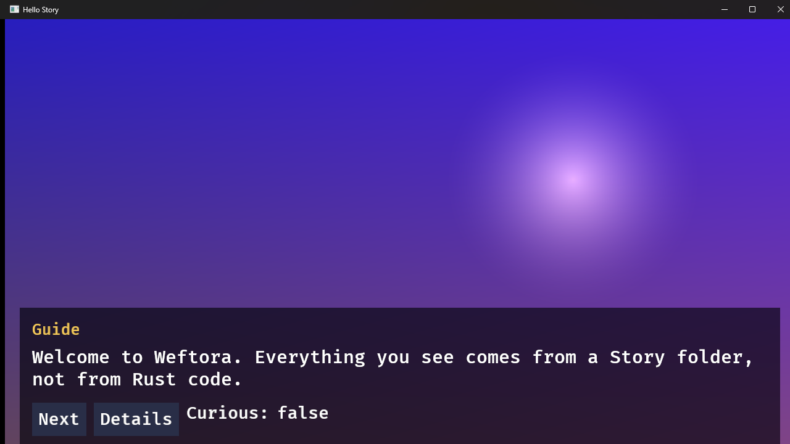
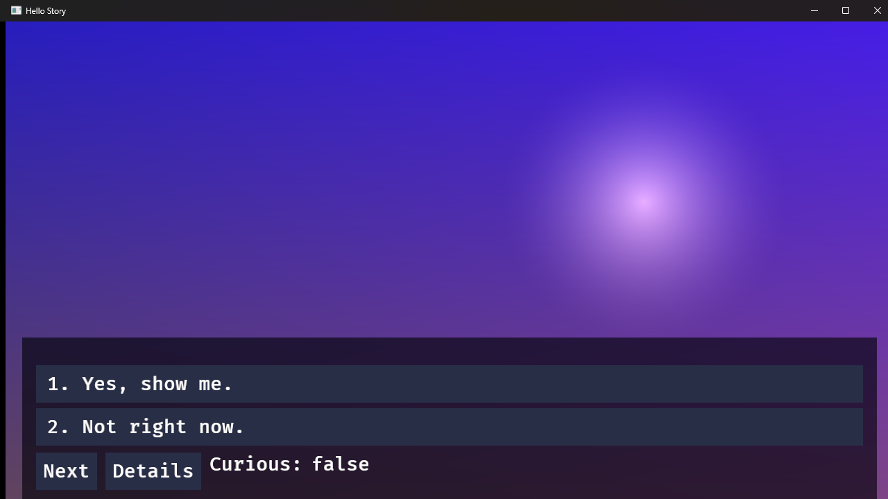
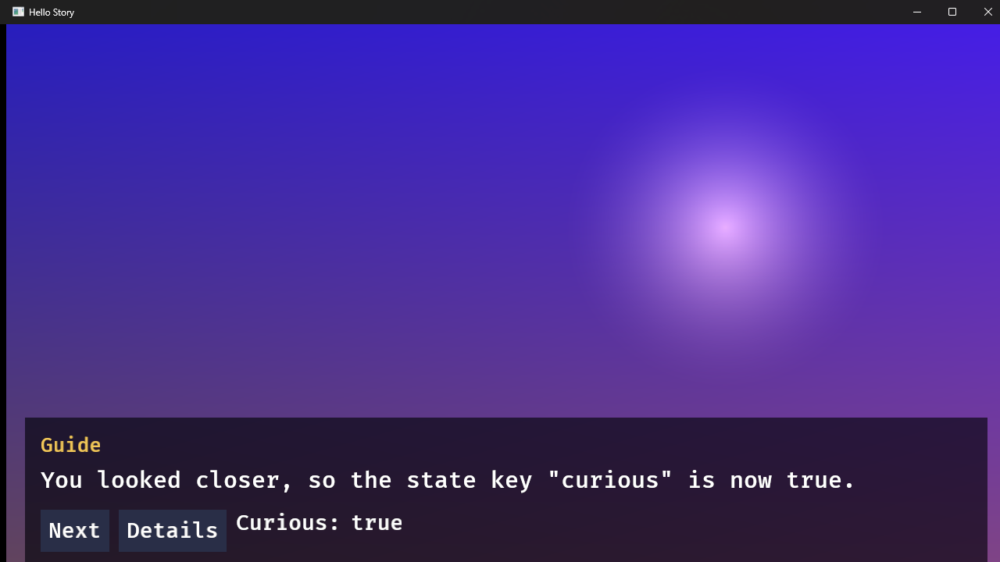
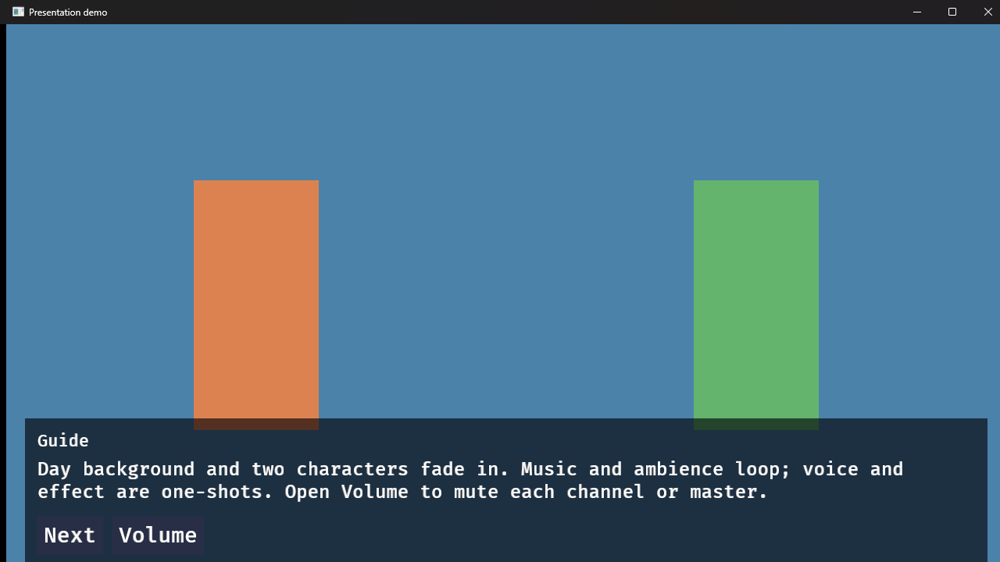
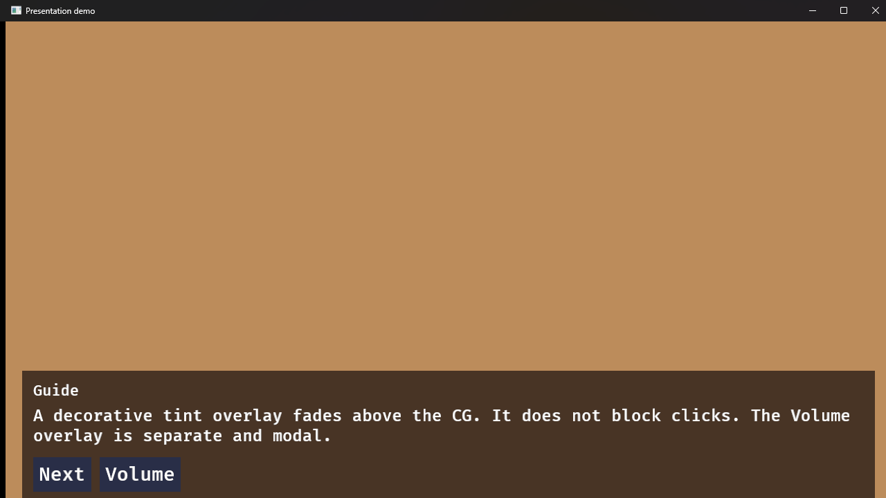

# Phase 2 Windows Agent-Run Evidence

Agent-executed results for the [Phase 2 checks](../success-criteria.md#phase-2--dialogue-and-presentation) on a
real Windows machine. This is a **third, separate** evidence stream. It is not
[CI](./phase-2.md) (those run on GitHub runners) and it is **not** the maintainer's manual record
([Phase 2 Windows manual verification](./phase-2-windows.md), tracked by [issue #5](https://github.com/cunilab/Weftora/issues/5)).

An agent built the player, exported real Story packages, launched real windows, drove them with real
keyboard input, captured real rendered frames with `PrintWindow`, replayed both choice branches
deterministically, and measured process-level startup and memory. It closes none of the maintainer's
checklist boxes and does not by itself satisfy the Phase 2 gate. The gate owner and the human-observed
items remain with the maintainer.

## What this does NOT cover

The following stay open for the maintainer and are deliberately **not** claimed here, because an agent
cannot perform or honestly infer them on this host:

- **Audio (P2-05).** No claim that music, ambience, voice or effect are audible, correctly routed, or
  loop cleanly. Audio commands dispatch (see the headless trace) but sound is not evidence.
- **Clean-machine export (P0-10, Phase 6).** This host has Rust and Cargo installed, so the
  Rust-free-machine export requirement is not tested here. It stays deferred under [issue #5](https://github.com/cunilab/Weftora/issues/5).
- **Human perception.** Text "readability", DPI feel, colour, layout taste and click-through behaviour of
  decorative overlays are not judged. Frames are attached so the maintainer can judge them.
- **Input-to-feedback p95 (R15).** Not measured; it needs a controlled input-latency harness, not an
  estimate. Left blank.

## Environment

- **OS:** Windows 11 Pro 10.0.26300 (64-bit)
- **CPU:** 13th Gen Intel Core i7-13620H (10 cores / 16 threads)
- **GPU:** NVIDIA GeForce RTX 4050 Laptop GPU, driver 32.0.16.1062 (Vulkan/Bevy path); Intel UHD Graphics present
- **Audio device (enumerated, not exercised):** Realtek High Definition Audio
- **Rust:** 1.98.0 (pinned toolchain)
- **Commit:** `c9f2aa03716e30057a4d8baa135018b5a8a45063` (the Phase 2 merged revision)
- **Builds:** `cargo build -p weftora-cli -p weftora-player --locked` (debug) and `--release`, both from the
  commit above.

Hardware facts were read from the machine (`Win32_OperatingSystem`, `Win32_Processor`, `Win32_VideoController`,
`Win32_SoundDevice`); they are objective enumerations, not maintainer observations.

## Method

- **Deterministic replay (no window):** `weftora run <story> --headless [--choices …]` emits a JSON-lines
  trace of lines, commands, choices, canonical state changes, signals and the lifecycle trace. Both branches
  were replayed by feeding explicit choice indices.
- **Real window and frame capture:** the exported `weftora-player.exe` was launched in this agent's own
  Windows session (so the session-boundary limitation that blocked phase-0 `PrintWindow` capture does not
  apply here), driven with real `SendKeys` space/digit input, and captured at 1280×720 with
  `PrintWindow(PW_RENDERFULLCONTENT)`. Frames are committed under
  [`artifacts/phase-2-windows-agent/`](./artifacts/phase-2-windows-agent).
- **Perf:** a PowerShell harness launched the exported release player, waited until the primary window
  carried the expected title (window-ready), then sampled `WorkingSet64` and `PrivateMemorySize64` after a
  settle period. See [`perf-release.txt`](./artifacts/phase-2-windows-agent/perf-release.txt).

## Results

"Observed" means the agent ran the scenario and recorded the real outcome. It is not a gate PASS; closing a
Phase 2 checkbox still requires the maintainer per the [success criteria](../success-criteria.md#phase-2--dialogue-and-presentation).

| Check | What the agent ran | Observed | Artifact |
| --- | --- | --- | --- |
| P2-01 choice → canonical state → view binding → later Yarn condition | Headless both branches; live window before/after choosing "Yes" | Choice 0 → `curious` false→true (scope `persistent`) with `state.changed` signal, `if $curious` true line; choice 1 → stays false, no change. Window binding flips `Curious: false` → `Curious: true` | [branch A](./artifacts/phase-2-windows-agent/headless-branch-a.jsonl), [branch B](./artifacts/phase-2-windows-agent/headless-branch-b.jsonl), [frame](./artifacts/phase-2-windows-agent/hello-2-curious-true.png) |
| P2-02 invalid syntax / missing node / unknown command diagnostics | `weftora check` on three negative fixtures plus a missing-asset fixture | Each fails with `file:line` and node context, nonzero exit, no panic | [error-paths.txt](./artifacts/phase-2-windows-agent/error-paths.txt) |
| P2-03 compiled-dialogue boundary | (Covered by CI and [phase-2.md](./phase-2.md); not re-run here) | — | — |
| P2-04 background, two characters, CG, overlay, move/scale/opacity/crossfade | Real windows of `presentation-demo` at several depths; all 25 commands headless | Day→night crossfade, two character rectangles at different positions/scales/opacity, CG + tint overlay stacked and cleaned up | [day](./artifacts/phase-2-windows-agent/demo-0-day-characters.png), [night](./artifacts/phase-2-windows-agent/demo-1-night-characters.png), [CG+overlay](./artifacts/phase-2-windows-agent/demo-2-cg-overlay.png), [trace](./artifacts/phase-2-windows-agent/headless-presentation.jsonl) |
| P2-05 audio | (Not covered — see above) | Commands dispatch; audibility not claimed | [trace](./artifacts/phase-2-windows-agent/headless-presentation.jsonl) |
| P2-06 widgets, bindings, keyboard/mouse focus | Real windows: dialogue widgets, Next/Details, choice list, first-choice focus, live `Curious` binding; window resize to 684×461; Details overlay opened, state set and closed via keyboard | Widgets render; text wraps and re-wraps on resize without overflow; choice list renders with first option focused; digit key selects a choice; Details overlay opens, its `state.set` button flips the base `Curious` binding to `true` without advancing dialogue | [opening](./artifacts/phase-2-windows-agent/hello-0-opening.png), [choices](./artifacts/phase-2-windows-agent/hello-1-choices.png), [resized](./artifacts/phase-2-windows-agent/hello-resize-narrow.png), [Details overlay](./artifacts/phase-2-windows-agent/hello-details-overlay.png), [after set](./artifacts/phase-2-windows-agent/hello-details-after-set.png) |
| P2-07 adapters / pins / licences | (Covered by CI dependency job and [phase-2.md](./phase-2.md)) | — | — |
| P2-08 performance baseline (R15) | Release build, 7 launches + 7 `check` runs | Cold start to window ≤ 0.59 s (warm), first-ever cold launch 1.86 s; idle 371 MiB working set / ~625 MiB private; `check` median 11 ms. All within R15 except input-p95, not measured | [perf-release.txt](./artifacts/phase-2-windows-agent/perf-release.txt) |
| P2-09 catalog IDs resolve; bad/duplicate IDs reported with file and location | `weftora check` on a missing-ID fixture and a duplicate-ID fixture; corrupt image bytes at check and at render | Missing ID → `file:line` + node; duplicate ID → `assets/images.jsonc: /1/id: … first declared at …/0/id` (JSON-pointer location); corrupt image passes `check` and the player does **not** panic (image just fails to render) | [error-paths.txt](./artifacts/phase-2-windows-agent/error-paths.txt), [asset-id-media.txt](./artifacts/phase-2-windows-agent/asset-id-media.txt) |
| P2-10 renderer chosen by ADR | (ADR 0005; not re-run here) | — | — |

### Export integrity and hashes

Both example Stories export cleanly; the same player binary ships in both (locally reproducing CI's
same-player invariant), and a stale/tampered package is rejected before any window opens. Full listings and
SHA-256 values are in
[`package-and-hashes.txt`](./artifacts/phase-2-windows-agent/package-and-hashes.txt) and
[`runtime-behavior.txt`](./artifacts/phase-2-windows-agent/runtime-behavior.txt):

- Exported release player SHA-256: `612f956035bcfe57009f28df36234a3e8563900f0d34b31cda0b9b8903d2bfec`
- `hello-story` exports 9 story files; `presentation-demo` exports 17.
- Editing exported Yarn without re-exporting → `stale dialogue artifact: inputHash does not match the Story sources`, exit 1.
- A valid Story returns exit 0 on both normal window close and Escape.
- A Story that doubles a string fifteen times fails with `string budget (16384) exceeded in node 'Start'`, exit 1.

### Frames

Captured from the release build at 1280×720 with `PrintWindow`. These are real rendered windows on this
machine, offered so the maintainer can judge the visual items without trusting an agent's description.

Hello Story — opening, choice list, and after choosing "Yes":







Presentation demo — day background with two characters, then CG over the character layer with a tint overlay:





## Interactive overlays and decorative click-through

Driven with real keyboard/mouse input against the release build.

- **Details overlay (modal).** Tab to `Details`, Enter opens the Story-defined overlay (dimmed base behind,
  `curious` binding shown). Activating *Set curious to true* then closing returns to the base dialogue with
  **`Curious: true`** and the dialogue line unchanged — an overlay action updated canonical state and the base
  binding without advancing. [open](./artifacts/phase-2-windows-agent/hello-details-overlay.png),
  [after](./artifacts/phase-2-windows-agent/hello-details-after-set.png).
- **Resize.** Shrinking the window to 684×461 re-wraps the dialogue text without overflow; widgets and the
  state label stay inside the panel. [frame](./artifacts/phase-2-windows-agent/hello-resize-narrow.png).
- **Decorative click-through — resolved as a harness artifact.** With synthetic (injected) clicks, a
  background click advanced when only the background layer was present (control,
  [frame](./artifacts/phase-2-windows-agent/demo-click-control-advanced.png)) but did **not** advance when
  CG/tint covered the point, reproduced in 4 runs
  ([frame](./artifacts/phase-2-windows-agent/demo-click-cg-blocked.png)). That initially looked like decorative
  media intercepting clicks. It was later shown that injected clicks in this harness fall through interactive
  widgets as well (a click dead-centre on a choice row did nothing), while the maintainer's real mouse
  activates the same UI correctly. The maintainer then ran the definitive real-click test at the tint step:
  the click **passed through the decorative overlay and advanced the dialogue** (issue #5, Q9-A). Verdict:
  decorative media does **not** block clicks; the earlier non-advance was an injected-input artifact, kept here
  as an honest trace of the method's limits.

The presentation-demo's Volume overlay did not open reliably through scripted Tab focus (focus order varied
between launches), so its modal behaviour is not claimed here; the modal mechanism itself is demonstrated by
the Details overlay above. Volume's *audio* effect belongs to the maintainer's P2-05 check.

## Performance baseline vs PRD R15

[R15](../../PRD.md#5-requirements) provisional budgets, compared with the release measurements above (single
machine, agent harness). This is a baseline observation, not an ADR revision.

| Budget (R15) | Measured (release) | Within budget? |
| --- | --- | --- |
| Cold start to menu ≤ 5 s | window-ready median 0.51 s, max 0.59 s warm; 1.86 s on the first-ever launch | Yes |
| Idle memory ≤ 750 MiB per sample Story | 371 MiB working set / ~625 MiB private | Yes |
| `weftora check` on starter Story ≤ 2 s | median 11 ms | Yes |
| Input-to-feedback p95 ≤ 100 ms | not measured | not claimed |

## Limitations

- Startup is measured as **process launch → first titled window (window-ready)**, not a fully rendered
  interactive frame; the two are close on this Story but are not identical definitions of "menu".
- Idle memory is the player process's working set / private bytes; it does not include driver or OS-shared
  pages beyond what the process reports.
- Perf numbers are from one machine and one harness run each; they are a baseline, not a multi-run statistics
  package. [ADR 0006](../adr/0006-performance-baseline.md) records this baseline, confirms the measured R15
  budgets and leaves p95 open per P2-08.
- Synthetic click injection proved unreliable for interactive targets in this harness (clicks fell through
  widgets; frame-capture and keystroke delivery also varied). Every click-dependent conclusion was therefore
  re-tested with the maintainer's real mouse (issue #5, Q6/Q7/Q9), which is what the linked records cite.
  Input-to-feedback p95 was not measured (frame-capture cost exceeds the latency being measured).

## Reproduction

```text
cargo build -p weftora-cli -p weftora-player --locked          # add --release for perf
cargo run -p weftora-cli -- check examples/hello-story
cargo run -p weftora-cli -- run examples/hello-story --headless --choices 0   # branch A
cargo run -p weftora-cli -- run examples/hello-story --headless --choices 1   # branch B
cargo run -p weftora-cli -- run examples/presentation-demo --headless
cargo run -p weftora-cli -- export examples/hello-story --out <empty-dir>
<empty-dir>/weftora-player.exe <empty-dir>/story --validate
cargo run -p weftora-cli -- export examples/presentation-demo --out <empty-dir2>
```

Frame capture and perf require launching the exported player in an interactive Windows session; the exact
harness commands are recorded in the artifact headers.
