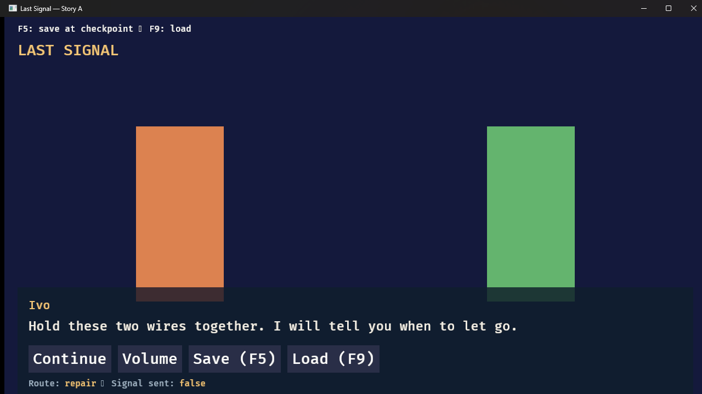
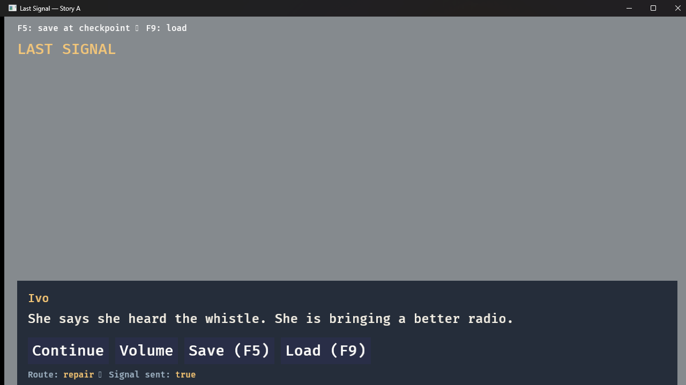
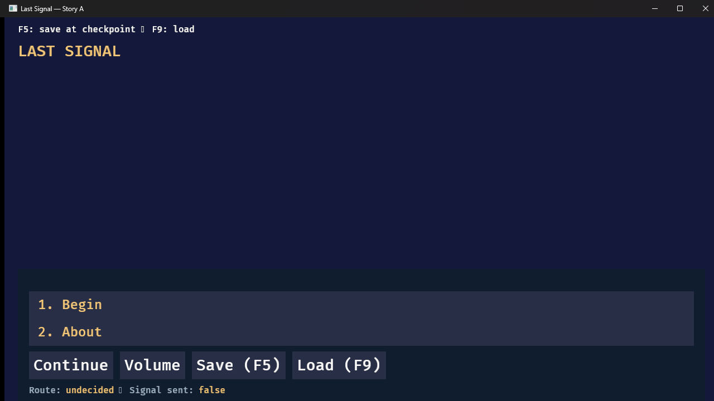
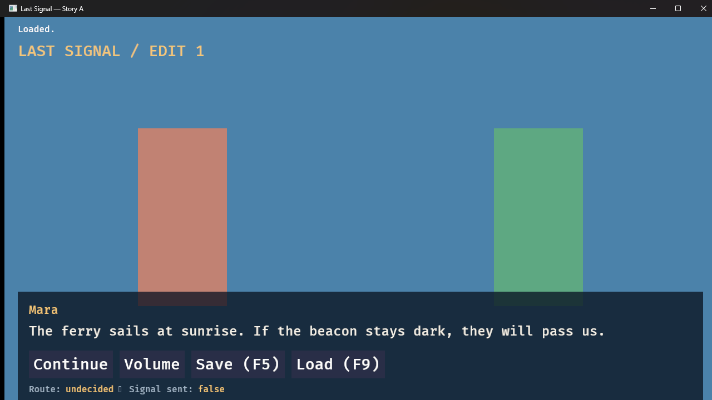
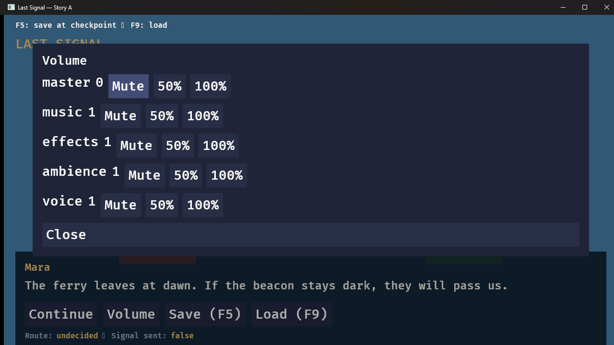
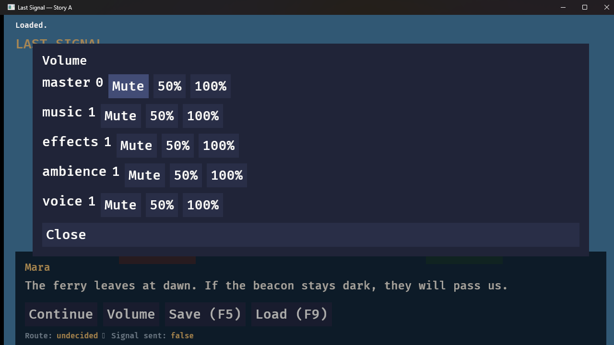

# Phase 3 Windows Agent-Run Evidence

Agent-executed results for the [Phase 3 checks](../success-criteria.md#phase-3--first-playable-visual-novel-and-saves) on a
real Windows machine. This is a **third, separate** evidence stream, following
[Phase 2 Windows agent-run evidence](./phase-2-windows-agent.md). It is not [CI](./phase-3.md) and it is
**not** the maintainer's manual record ([Phase 3 Windows manual verification](./phase-3-windows.md),
tracked by [issue #5](https://github.com/cunilab/Weftora/issues/5)).

An agent built the release binaries from the merged Phase 3 revision, ran the same-player proof script,
replayed both Story A routes headless, exported and edited real Story packages, launched the real player,
drove it with real keyboard input (F5/F9/Tab/Enter/digits), captured real rendered frames with
`PrintWindow`, exercised the save directory on disk (bytes, backups, corruption, removal) and hashed every
save transition. It closes none of the maintainer's checklist boxes and does not by itself satisfy the
Phase 3 gate. The gate owner and the human-observed items remain with the maintainer. The later [evidence reconciliation](phase-3.md#historical-windows-evidence-review) reviews this original battery alongside the paired-session records.

## Original battery scope

This page records the original battery at `48a965b`. Later paired-session records in [manual verification](phase-3-windows.md#maintainer-records) add maintainer audio/mouse observations and agent-run simultaneous-key and real-DPI checks. The exclusions below describe this original battery, not the combined evidence. P3-07 remains open.

Deliberately **not** claimed by this original battery:

- **Audio (P3-01, part of P3-05).** No claim that music/ambience loop audibly, that effect tones sound
  correct, or that Volume changes are heard. Audio *commands* dispatch (headless traces) and the Volume
  overlay changes canonical `settings.audio.*` state (frames), but sound is not evidence.
- **Real-mouse route completion (P3-03).** Synthetic click injection proved unreliable in this harness in
  Phase 2 (clicks fell through widgets); routes were completed with keyboard (digits/Tab/Enter), which the
  About screen documents as first-class input. Click behaviour stays with the maintainer's real mouse.
- **Windows DPI scale (P3-03).** Changing the OS display scale was not done on the maintainer's machine.
  Window *resize* to 900×600 and back is covered; per-monitor DPI readability is not.
- **Same-frame combinations (P3-03).** `SendKeys` cannot produce F5+Space or key+click in one frame; the
  combined-input rules stay maintainer-observed.
- **P3-07 independent author.** Requires someone other than the tutorial author to perform the walkthrough. Not claimed.
- **Frames are attached so the maintainer can judge the visual items without trusting a description.**

## Environment

- **OS:** Windows 11 Pro 10.0.26300 (64-bit)
- **CPU:** 13th Gen Intel Core i7-13620H (10 cores / 16 threads)
- **GPU:** NVIDIA GeForce RTX 4050 Laptop GPU, driver 32.0.16.1062 (Vulkan/Bevy path)
- **Audio device (enumerated, not exercised):** Realtek High Definition Audio
- **Rust:** 1.98.0 (pinned toolchain)
- **Commit:** `48a965b` (the Phase 3 merged revision, main)
- **Builds:** `cargo build --release` from the commit above; gates re-run on the same tree:
  `cargo test --workspace --all-targets` exit 0, `cargo clippy --workspace --all-targets -- -D warnings` exit 0
- **Release player SHA-256:** `0689bd5829b55c7d28aa53ce8003318c27e471ead53617df9b4b6e1b7521d26f`
- **Release CLI SHA-256:** `4ee2954eb3e527102b4dbd45306ec7ec03c0e6d8e610737ddbe972e9fc76858d`
- **Save directory used by the real player:** `%LOCALAPPDATA%\Weftora\saves\dev.weftora.story-a\`
  (`save.json`, `save.bak`); it did not exist before these runs.

## Method

- **Deterministic replay (no window):** `weftora run <story> --headless --choices <i,…> [--save-at <id>]
  [--load] [--save-dir <dir>]` emits JSON-lines traces and end-state snapshots.
- **Same-player proof:** `scripts/verify-story-a-edits.py` exports baseline + two edited variants with one
  CLI/player pair, asserts equal player hashes, creates a baseline `scene.arrival` save headlessly and
  loads it into the text-patched variant.
- **Real window and frame capture:** the exported `weftora-player.exe` was launched in this agent's own
  Windows session and driven with real `SendKeys` input (warmup key, digits, space, Tab, Enter, `{F5}`,
  `{F9}`), captured at 1280×720 with `PrintWindow(PW_RENDERFULLCONTENT)` after each action. Frames are
  committed under [`artifacts/phase-3-windows-agent/`](./artifacts/phase-3-windows-agent).
- **Save bytes:** every save transition was hashed on disk (`Get-FileHash SHA256`) and parsed
  (`checkpoint.id`, `state.story.*`); backups were compared byte-for-byte with the previous slot.

## Results

"Observed" means the agent ran the scenario and recorded the real outcome — not a gate PASS.

| Check | What the agent ran | Observed | Artifact |
| --- | --- | --- | --- |
| P3-01 Complete Story A (visual/state parts) | Real window, keyboard only: menu → About → Return → Begin → both routes → dawn → end; headless both routes | Menu offers Begin/About; About returns to an identical menu; both routes complete with distinct dawn replies; `Route:` binding flips at the first route line; `Signal sent:` flips true by dawn; headless end states: `route=repair`/`route=roof`, `attempts=1.0`, `signal=true`. **Audio loop/quality not claimed** | [menu after return](./artifacts/phase-3-windows-agent/menu-after-about-return.png), [decision](./artifacts/phase-3-windows-agent/decision-choices.png), [repair](./artifacts/phase-3-windows-agent/dawn-repair-reply.png), [roof](./artifacts/phase-3-windows-agent/dawn-roof-reply.png), [traces](./artifacts/phase-3-windows-agent/headless-route-repair.jsonl) |
| P3-02 Same-player edits | Proof script (3 exports, hashes), then real players: baseline save → text-patched variant F9, theme/image variant | All three exports ship the identical player (`0689bd…`); patched banner `LAST SIGNAL / EDIT 1` and edited sentence `The ferry sails at sunrise…` render; baseline arrival save loads into the patched player (`Loaded.`) with state retained; theme variant shows the recolored panel + replaced day image; save bytes unchanged by loading | [banner](./artifacts/phase-3-windows-agent/edit1-menu-banner.png), [loaded sentence](./artifacts/phase-3-windows-agent/edit1-loaded-sentence.png), [theme](./artifacts/phase-3-windows-agent/edit2-theme-image.png) |
| P3-03 Input, focus, resize | Keyboard route completion; Tab order; overlay modal blocking; F5/F9 under overlays; resize 900×600 | Tab order Continue→Volume→Save→Load; Enter/Space activate the focused button **without advancing the line**; digits choose choices; Volume overlay opens modally, blocks dialogue input (digit probe ignored), F5 refused while open; Close restores focus to Volume by ID; load resets focus; 900×600 reflow readable. **Mouse, DPI scale, same-frame combinations not claimed** | [overlay](./artifacts/phase-3-windows-agent/volume-overlay-open.png), [F5 refused](./artifacts/phase-3-windows-agent/f5-refuse-overlay-open.png), [focus restore](./artifacts/phase-3-windows-agent/close-focus-restore.png), [resized](./artifacts/phase-3-windows-agent/resize-900x600.png) |
| P3-04 Save/load behavior | F5 at first display / during fades / at later lines; quit-relaunch-F9; attempts via save bodies; volume retention; overlay F5/F9; menu choice refresh | Exact status messages observed (below); restore returns the exact first display with scene and state (`route`, `signal`) rebuilt; `story.attempts` increments exactly once through save→load→finish→re-save (1.0, never 2.0); changed volume Setting survives a load; F9 with the overlay open returns to the initial base; a menu-checkpoint load refreshes the choice text | [restore](./artifacts/phase-3-windows-agent/f9-loaded-repair-restore.png), [Saved at dawn](./artifacts/phase-3-windows-agent/f5-saved-dawn.png), [retained](./artifacts/phase-3-windows-agent/master-0-retained-after-load.png), [choice refresh](./artifacts/phase-3-windows-agent/f9-menu-choice-refresh.png) |
| P3-05 User data + failure behavior | Real `%LOCALAPPDATA%` slot; two consecutive saves; corrupt file + F9; restore + F9; missing directory + F9 | Saves land at `…\Weftora\saves\dev.weftora.story-a\save.json`; `save.bak` equals the previous slot byte-for-byte (verified twice); corrupt slot → nonfatal status `corrupt save: key must be a string at line 1 column 2`, game stays alive, slot bytes unchanged; restored file loads; missing slot → `no save file exists`, no silent slot created | [corrupt](./artifacts/phase-3-windows-agent/corrupt-save-nonfatal.png), [restored](./artifacts/phase-3-windows-agent/restored-save-loads.png), [missing](./artifacts/phase-3-windows-agent/missing-slot-message.png) |
| P3-06 Compatibility | Headless: load baseline arrival save with `scene.arrival` removed; with `saveSchema` bumped to 2; save→load→finish attempts chain | Both refusals exit 1 with exact text and leave the slot bytes untouched: `save checkpoint 'scene.arrival' is not available`; `no save migration from schema 1 to 2`; baseline save loads into the text-patched variant (see P3-02); attempts stays 1.0 across load/finish/re-save | [compat-refusals.txt](./artifacts/phase-3-windows-agent/compat-refusals.txt) |
| P3-07 Independent author | (Not covered — requires someone other than the tutorial author) | — | — |

### Exact status messages observed (real window, adapter-owned status line)

| Situation | Message |
| --- | --- |
| F5 after fades at first display | `Saved.` |
| F9 | `Loaded.` |
| F5 while view/audio transition active (roof's 1000 ms move) | `Save/load: wait for the view/audio transition before saving` |
| F5 at a later line | `Save/load: save is available only at the first line or choice after a checkpoint` |
| F5 while the Volume overlay is open | `Save/load: close overlays and return to the initial screen before saving` |
| F9 on a corrupt slot | `Save/load: corrupt save: key must be a string at line 1 column 2` |
| F9 with no slot | `Save/load: no save file exists` |

### Save chain (hashes on disk, `SHA-256`)

| Save | `checkpoint.id` | `state.story.*` | Slot hash | `save.bak` verified equal to |
| --- | --- | --- | --- | --- |
| arrival (player F5) | `scene.arrival` | route undecided, attempts 0.0 | `17379b0c…` (byte-identical to the headless proof save) | — |
| repair (player F5) | `scene.repair` | route repair, attempts 0.0 | `FAFF61F1…` | previous slot (arrival) ✓ |
| dawn (player F5, after F9 + progress) | `scene.dawn` | route repair, attempts **1.0**, signal true | `2AB0297A…` | previous slot (repair) ✓ |
| corrupt (agent-written garbage) | — | — | `526F50D0…`, unchanged by a failed F9 ✓ | — |

The player save captures checkpoint-boundary state (repair first display stores `attempts=0.0` because the
node's `+1` command runs when the first line opens); loading replays the node so the increment applies
exactly once (`attempts=1.0` at dawn and at story end), matching the headless chain
([trace](./artifacts/phase-3-windows-agent/compat-refusals.txt)).

### Same-player proof (P3-02)

`scripts/verify-story-a-edits.py` (release CLI + player) reported three validated exports with one player
hash `0689bd58…`, differing dialogue/screen/image hashes per variant, `baseline Arrival save created`, and
the text-patched variant loading that save with the edited first line while the save file stayed
byte-identical. The interactive players then showed the same facts in real windows
([banner](./artifacts/phase-3-windows-agent/edit1-menu-banner.png),
[load](./artifacts/phase-3-windows-agent/edit1-loaded-sentence.png),
[theme/image](./artifacts/phase-3-windows-agent/edit2-theme-image.png)). Variant packages contain
`story/` + `compiled/` only; the baseline player runs them, as the verification steps prescribe.

## Frames

Repair route — first line with the `Route: repair` flip, the repair-specific dawn reply with
`Signal sent: true`, and The End:





Menu rebuilt after About → Return, and the text-patched variant's loaded save:





Volume overlay (master changed to 0) and the retained value after a load:





## Harness findings (honest trace of the method)

- **First input after boot is swallowed.** In several runs the first keystroke sent to a freshly focused
  window was lost (a digit at the title menu did nothing while later identical digits worked). All
  subsequent drives prepend a harmless warmup `space` (a no-op at a choice-only screen) and use a
  redundant digit press at critical choices. The original report attributed this to `SendKeys` focus hand-off because subsequent inputs arrived within one extra press. Its referenced `repair-final-s2` frame was not included in PR #21, so this attribution is not independently established by the imported artifacts.
- **Per-step frame capture costs ~0.3–0.8 s**, so a 500 ms fade window cannot be caught between actions.
  The during-fade refusal was therefore demonstrated against roof's 1000 ms move transition
  ([frame](./artifacts/phase-3-windows-agent/f5-refuse-mid-transition.png)) — shared settled-media guard; see [the player save-request handler](../../crates/weftora-render-bevy/src/lib.rs). This is a different transition duration, not a direct observation of the Arrival fade.
- **Focus order is deterministic** on this Story: after boot Tab starts at Continue; after a load, focus
  resets to Continue; an overlay focuses its first button; `screen.close` restores the previous focus by
  widget ID (observed: Volume highlighted again).
- The original battery used digits/Enter at choice points. The later real-DPI record observed Space confirming the default choice on the Decision screen; the original claim that Space never activates choices is superseded by that observation. This does not establish a complete input rule for every focus state.

## Reproduction

These commands select release tools consistently with the recorded profile; they are reproduction instructions, not retained transcripts of the original run.

```text
cargo build --release
cargo run --release -p weftora-cli -- run examples/story-a --headless --choices 0,0    # repair
cargo run --release -p weftora-cli -- run examples/story-a --headless --choices 0,1    # roof
python scripts/verify-story-a-edits.py --cli target/release/weftora.exe --player target/release/weftora-player.exe --out <out>
# refusals: remove `<<checkpoint scene.arrival>>` or bump "saveSchema" to 2, then
cargo run --release -p weftora-cli -- run <fixture> --headless --load --save-dir <compatibility-save>
```

Frame capture requires launching the exported player in an interactive Windows session; the exact drive
sequences (warmup + actions) are recorded in this document and in the frame filenames' order of capture.
