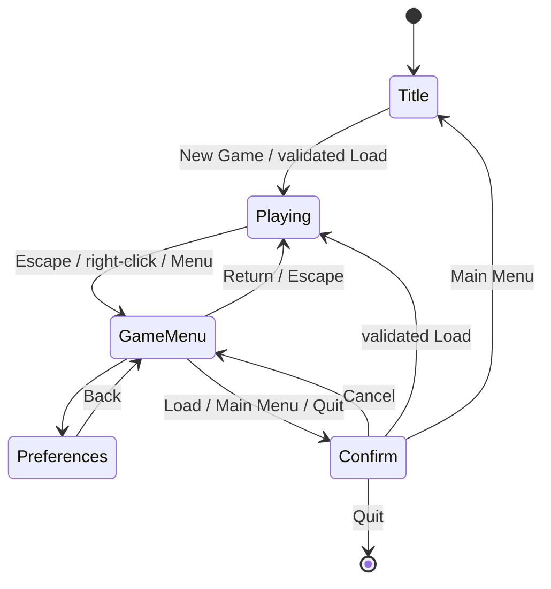

# Ren'Py workflow comparison and player UX plan

Reviewed 2026-10-23 against official Ren'Py documentation and its GUI template source. This is a source and workflow review, not a hands-on Ren'Py usability test. Weftora's previous visual pass is implemented, but the player experience is not accepted. Modern styling remains the direction; predictable navigation and progress safety come first.

## Findings

| Player task | Ren'Py reference | Current Weftora gap | Required change |
| --- | --- | --- | --- |
| Start or resume | Separate main menu and gameplay | Runner executes immediately; Story A simulates a menu with Begin/About choices | Real title lifecycle with New Game, Load, Preferences and Quit; Continue only when a usable save exists |
| Pause and return | Game menu with Return and shared navigation | Escape closes overlays, then double-Escape quits | Escape/right-click opens the game menu; Return restores the same interaction |
| Make a decision | Dedicated choice screen; authored menu captions can accompany options | Switching to Choices clears dialogue bindings | Preserve appropriate decision context with the options, without stale text from another scene |
| Save and load | Dedicated file screens and confirmation actions | One save file, immediate load/overwrite, checkpoint refusals after clicking | Show availability and reasons before the action; confirm destructive operations; accurately describe the single checkpoint save |
| Read comfortably | Dialogue, quick menu and preferences have distinct roles | Volume controls and Story debug booleans crowd the dialogue panel | Keep reading controls sparse; move preferences to their screen and debugging to F12 |
| Recover missed text | History and rollback are separate facilities | Neither exists | Read-only history first; rollback needs a separate state-restoration design |
| Set preferences | Dedicated preference controls | Example buttons set 0/50/100; Settings survive load but not application restart | Actual controls and persistence across launches |
| Create a project | Graphical launcher for project management and running | CLI new/check/run/export only | Separate author-experience decision after the player flow |

Reference: [special screens](https://www.renpy.org/doc/html/screen_special.html), [GUI template](https://github.com/renpy/renpy/blob/master/gui/game/screens.rpy), [menu captions](https://www.renpy.org/doc/html/menus.html), [screen actions](https://www.renpy.org/doc/html/screen_actions.html), [launcher workflow](https://www.renpy.org/doc/html/quickstart.html). The template link tracks mutable master; this review records the observed patterns, not a pinned dependency or code to copy.

Ren'Py maps Escape/right-click to the game menu, and Enter/Space/left-click to dismissal. We should adopt the familiar menu behavior while preserving keyboard focus navigation; copying its Tab-to-skip binding would conflict with Weftora's current Tab behavior. See the [official keymap](https://www.renpy.org/doc/html/keymap.html).

## Local evidence and limits

- [Player preparation](../crates/weftora-render-bevy/src/lib.rs) calls `Presenter::new`, which starts the runner immediately. [Story A](../examples/story-a/main.yarn) implements its Begin/About menu in Yarn.
- [Presenter](../crates/weftora-render-bevy/src/presenter.rs) replaces `Line` with `Choices`; [dialogue bindings](../crates/weftora-render-bevy/src/declarative.rs) clear speaker/text for choices. End text currently directs the player to double-Escape quit.
- [Story A's screen](../examples/story-a/ui/dialogue.jsonc) mixes reading, volume, save/load and Route/Signal values. The [UI action schema](../crates/weftora-story/src/ui.rs) lacks New Game, Game Menu and Quit actions.
- [Storage](../crates/weftora-save/src/storage.rs) uses `save.json` and `save.bak`, not multiple player-selected slots. [ADR 0007](./adr/0007-safe-checkpoint-saves.md) permits safe checkpoint reconstruction, not saving at any arbitrary line.

Ren'Py rollback restores game state around interactions; it is not a transcript viewer. Its save system also includes presentation and execution state. Weftora must not suggest equivalent behavior until commands, persistent writes, random state and media can be restored safely. See [saving, loading and rollback](https://www.renpy.org/doc/html/save_load_rollback.html).

## First development slice: player lifecycle and game menu

This is a target, not implemented behavior. The menu belongs outside the Story overlay stack: opening it must not invalidate an otherwise valid checkpoint. Suspend story input and progression while it is open; preserve the current line, choices, focus and pending command semantics on return. Define audio/transition suspension explicitly rather than assuming every clock can safely freeze.

Include honest save availability in this first slice. Disabled Save must explain the actual reason, and enabled Save must still validate at execution time. Do not silently rewind and call it saving the current position. Confirm before overwriting an existing save, loading over a session, returning to the title or quitting. Explain that unsaved progress will be lost; only name a last saved checkpoint when that information is known.

The shell must work for any compatible Story, without hardcoded Story A knowledge. Preserve existing Story entrypoints and the `--start-node` author preview contract; migrate example menu shims deliberately. Decide whether authored shell customization requires new schema actions under ADR 0002 before changing the public format. A schema bump is not assumed merely to add an engine-default menu.

Acceptance checks:

1. Cold launch reaches the title without executing Story commands or changing Story progress. Missing/invalid saves have a clear state; loading failures leave an active session intact.
2. At a line and a choice, open/close the menu with keyboard and pointer. No input advances the Story behind it; returning restores the same offer, context, focus and checkpoint eligibility without replaying commands.
3. Escape closes the top authored overlay first, returns from a submenu next, and otherwise opens/closes the game menu. Repeated Escape never quits. Window-close requests follow the same progress-loss confirmation policy.
4. Save availability matches checkpoint, pending-command, storage and overlay conditions; execution revalidates. Canceling overwrite/load/main-menu/quit leaves the session and save unchanged. Failed load remains transactional.
5. Reading chrome contains no debug state or volume presets. A decision retains useful context, including after language switching, without changing choice identity/order or showing stale text from another scene.

## Following slices and verification

1. Complete the lifecycle/menu slice above, including save availability and choice context. Keep the existing single-slot storage until a separate slot design is implemented.
2. Add read-only history, then real preferences with durable settings. Do not show nonfunctional History/Skip/Auto controls as placeholders.
3. Refine the modern visual system against the working flow: title composition, dialogue hierarchy, choice spacing, menu navigation, responsive layouts and focus/hover states. Review English, Indonesian and Japanese content.
4. Consider rollback, skip and auto only with explicit side-effect and timing rules. Treat a graphical author launcher as its own scope; reuse CLI operations if pursued.

Before and after implementation, record the same task walkthrough: launch, begin, choose, open menu, return, attempt save, quit/cancel, load/resume, change volume and recover a missed line. Record failures and unavailable tasks rather than inventing success. Use native macOS input now; queue Windows pointer/DPI/audio checks in [issue #5](https://github.com/cunilab/Weftora/issues/5) without blocking portable work. Recheck the existing performance budget when lifecycle changes land.

Claude Opus 5.5 at medium effort reviewed the supplied source findings without tool access. Its useful challenges were to combine menu work with save availability, bring choice context forward, and keep opening a menu free of Story side effects. This advisory is not independent code verification or native usability evidence.
